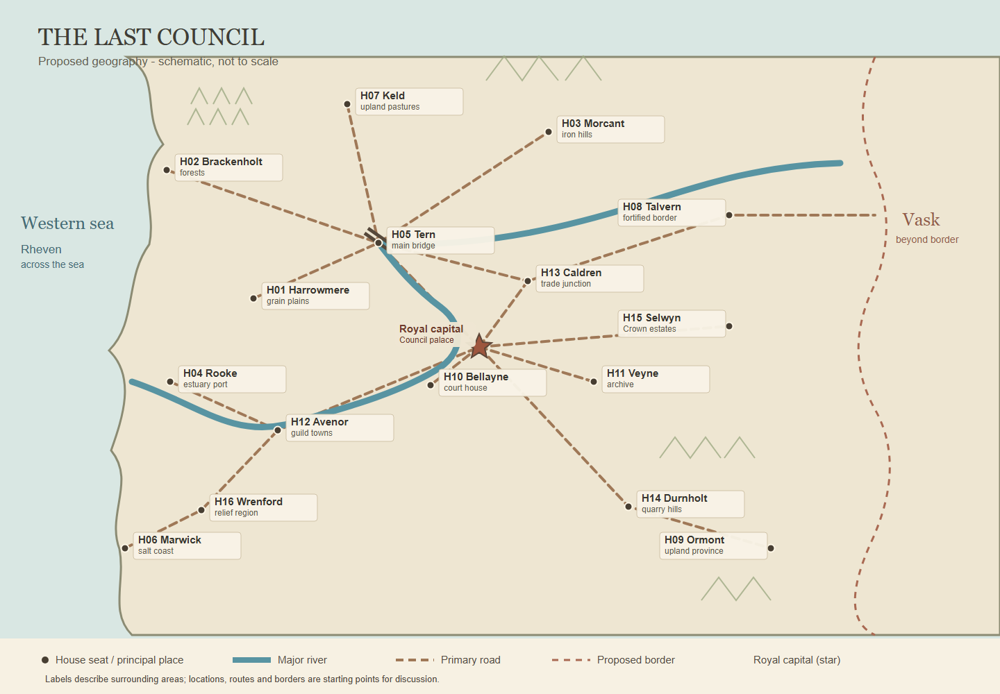

# Proposed geography

[Shared setting](SETTING.md) · [Houses](HOUSES.md)

[Editable SVG](maps/last-council-geography.svg) · [PNG reference](maps/last-council-geography.png)

This is a rough starting point for discussion, not a scale map. A dot marks a
House's proposed seat or principal place; the short description indicates the
surrounding area, not a defined territorial boundary. Bellayne's dot represents
its court house in the capital area. The royal capital and Council palace are
shown together. The Houses' home provinces and outside events can exist in the
story without being built on the palace map.

The blue line is an unnamed major river; the dashed brown lines are proposed
primary roads. Tern's main bridge connects the northern uplands with the route
to the capital. The river bends past the capital and Avenor before reaching Rooke's port. The dashed eastern
line suggests the land border with Vask; Rheven lies across the western sea.
These positions, routes and the border can all be changed. The diagram does not
show every road, river crossing, town or harbour.

| House | Proposed place | Main road connection shown |
|---|---|---|
| H01 Harrowmere | Central grain plains | Tern |
| H02 Brackenholt | North-western forests | Tern |
| H03 Morcant | North-eastern iron hills | Tern |
| H04 Rooke | Western estuary port | Avenor |
| H05 Tern | Main inland river crossing | Uplands, plains and capital |
| H06 Marwick | South-western salt coast | Wrenford |
| H07 Keld | Northern upland pastures | Tern and onward to capital |
| H08 Talvern | Fortified eastern border | Caldren, capital and Vask crossing |
| H09 Ormont | South-eastern upland province | Durnholt and capital |
| H10 Bellayne | Court house in the capital area | Capital |
| H11 Veyne | Archive near the capital | Capital |
| H12 Avenor | Lower-river guild towns | Rooke, Wrenford and capital |
| H13 Caldren | Central trade junction | Tern, capital and Talvern |
| H14 Durnholt | South-eastern quarry hills | Capital and Ormont |
| H15 Selwyn | Crown estates near the capital | Capital |
| H16 Wrenford | South-western inland relief region | Marwick and Avenor |

Roads and waterways are prompts for discussion, not automatic trade routes or
political alliances. The map adds no travel costs, resource needs, economic
simulation or automatic outcome to Council decisions. Every participating House
has an equal Council vote, wherever its home is placed.
